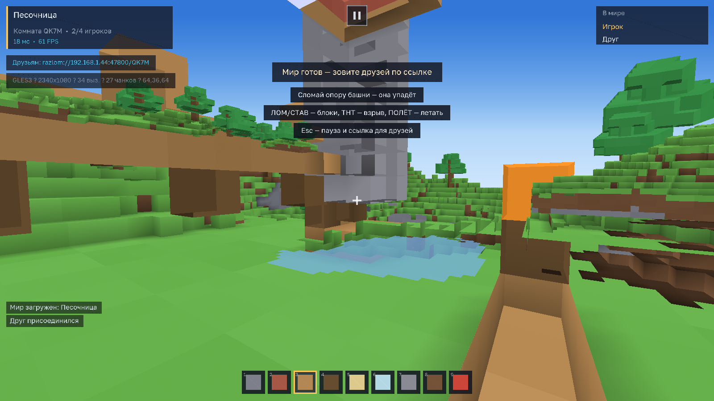
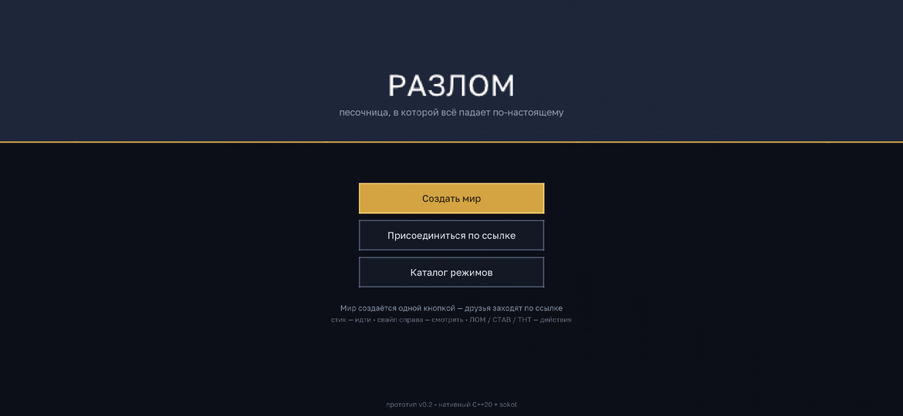
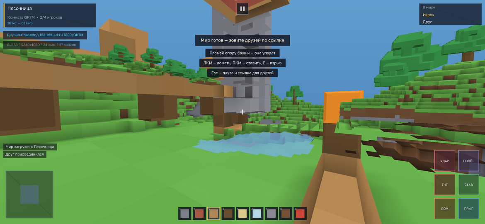
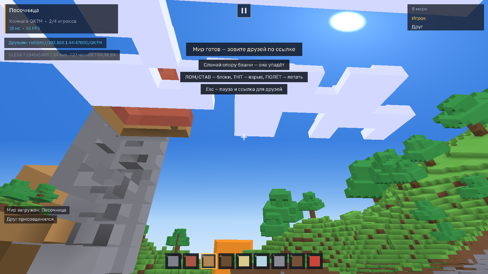

# РАЗЛОМ

**Песочница нового поколения.** Знакомая песочница, где всё ломается по-настоящему: уберёшь опору — башня падает, взрыв оставляет кратер, огонь перекидывается на дерево, вода течёт. Мир создаётся одной кнопкой, друзья заходят по ссылке, а режимы собираются в редакторе.

> Нативный **C++20** клиент и сервер на **sokol** (D3D11 / OpenGL / OpenGL ES 3.0). Без WebView, без Java, без Unity/Godot — один лёгкий бинарник под Windows, Linux и Android.



<p align="center">
  
  
</p>
<p align="center">
  
</p>

*Это настоящие кадры клиента, снятые CPU-превью (`make preview`) — тот же мешер, тот же
HUD, те же цвета. Сняты на 2340×1080 и 1600×900.*

---

## Что уже работает (вертикальный срез ядра)

| Столп | В прототипе |
|---|---|
| **Физика разрушения** | Несущие способности блоков, распространение запаса прочности от опор, обрушение конструкций, падающие обломки, кратеры от взрывов, огонь и вода как клеточные автоматы |
| **Мультиплеер без барьеров** | Авторитетный хост в потоке/отдельный сервер, мир по кнопке, вход по ссылке `razlom://host:port/CODE`, синхронизация правок, игроков, обломков и событий; 2–4 игрока (до 16) |
| **Игра внутри игры** | Каталог режимов с двумя играбельными режимами («Песочница», «Последний выживший») и каркасом «Защиты базы» — основа будущего редактора |
| **Игровой цикл** | Меню → мир → стройка/разрушение → PvP → смена режима; стартовая площадка с готовыми «мишенями»: башня на деревянных опорах, домик, мостик, ТНТ |
| **Монетизация** | Не реализована намеренно (pay-to-win исключён концепцией), точки расширения описаны в ROADMAP |

Проверено автотестами: **278 проверок ядра** (генерация, мешинг и winding, цвета граней, физика обрушения, вода, огонь, взрывы, протокол, сессия, сетевой хост с двумя клиентами) + **2597 проверок интерфейса** (атлас шрифта, белый тексель панелей, раскладка HUD на телефоне, попадания по кнопкам меню) + **111 проверок шейдеров** (uniform-блоки GLSL, имена uniform'ов, точки входа) + **60 проверок управления** (владение пальцами, дедзона стика, залипания).

---

## Управление

**ПК:** `WASD` — идти, `Shift` — бег (в полёте — вниз), `Space` — прыжок (удержание = автопрыжок), `F` или двойной `Space` — полёт (песочница), мышь — обзор, `ЛКМ` — ломать, `ПКМ` — ставить, колесо/`1..9` — слот, средняя кнопка — взять блок под прицелом, `Q` — удар (PvP), `E` — взрыв, `Esc`/`Tab` — пауза.

**Телефон/планшет:** левый стик — движение (чем дальше, тем быстрее; до упора — бег), свайп правой половиной — обзор, справа `ЛОМ` / `СТАВ` / `ТНТ` / `УДАР` / `ПРЫГ` / `ПОЛЁТ` (`ПРЫГ` держится — автопрыжок; в полёте поднимает), тап по хотбару — блок, кнопка `II` сверху — пауза. Полёт в песочнице: смотришь вниз и ведёшь стик вперёд — снижаешься.

**Друзья:** хост нажимает «Создать мир», копирует ссылку из паузы (`Esc` → «Скопировать ссылку») или из верхней панели. Гость вставляет её в «Присоединиться по ссылке» и играет в том же мире.

---

## Сборка

### Linux / macOS
```bash
cmake -B build -DCMAKE_BUILD_TYPE=Release
cmake --build build --parallel
./build/Razlom                     # клиент
./build/razlom_server --port 47800 # отдельный сервер
./build/razlom_tests               # автотесты
./build/razlom_bench               # бенчмарк ядра
```
Нужны `libx11-dev libxi-dev libxcursor-dev libgl1-mesa-dev` (Linux).

Без CMake (только ядро, тесты и сервер):
```bash
make test      # автотесты ядра и интерфейса
make bench     # замеры физики/мешинга
make server    # headless-хост
make check-client  # синтаксическая проверка клиентских исходников
make preview   # CPU-превью кадров (меню, HUD, мир) без GPU
```

### Как проверять без телефона и GPU

`make preview` собирает `tools/preview.cpp` — тот же мешер, та же физика и тот же HUD,
но растеризованные на CPU. Инструмент кладёт в `build/preview/out/` кадры всех экранов
(меню, каталог, загрузка, игра, пауза, взгляд в небо) на разрешениях 1280×760, 1600×900 и 2340×1080
и печатает число вершин интерфейса. Так видно, что именно увидит игрок: раскладку кнопок,
контраст, цвета мира и попадание текста в панели. Именно этот инструмент поймал два
грубых бага, которые не видел ни один автотест: белый (из-за двойного деления) мир и
полупрозрачные панели (UV белого текселя на границе с пустотой).

Пять наборов автотестов: `razlom_tests` (мир, физика, сеть), `razlom_ui_tests`
(шрифт, раскладка, кнопки), `razlom_shader_tests` (исходники GLSL/HLSL),
`razlom_controls_tests` (сенсорное управление) и `razlom_frame_tests` (небо,
облака, сторож кадра). Всё — без GPU и телефона: `make test`.

### Windows
```bat
cmake -B build -A x64 -DCMAKE_BUILD_TYPE=Release
cmake --build build --config Release --parallel
build\Release\Razlom.exe
```
Готовый `.exe` также собирается в CI (Direct3D 11, статический CRT) — забирайте артефакт `razlom-windows` со страницы Actions, а после влития в `main` обновляется релиз `latest`.

### Android
Нужен NDK 26+:
```bash
cmake -B build-android -G Ninja \
  -DCMAKE_TOOLCHAIN_FILE=$ANDROID_NDK/build/cmake/android.toolchain.cmake \
  -DANDROID_ABI=arm64-v8a -DANDROID_PLATFORM=android-26 \
  -DANDROID_STL=c++_static -DCMAKE_BUILD_TYPE=Release
cmake --build build-android -j
```
CI-конвейер [`.github/workflows/build.yml`](.github/workflows/build.yml) собирает и подписывает `Razlom-Android-arm64.apk` (NativeActivity, `hasCode=false`, GLES3) — артефакт `razlom-android`.

**Установка на телефон:** скачать артефакт и поставить поверх старой версии. Подпись стабильная —
отладочный ключ `game/android/debug.p12` лежит в репозитории (только для сайдлоада), `versionCode`
растёт номером сборки CI, поэтому обновление ставится без удаления игры. APK, собранный **до v0.2.1**,
подписан другим ключом — его один раз нужно удалить.

Размеры готовых сборок (архивы CI): `Razlom-Android-arm64.apk` — **0.39 МБ**, `.exe` — **0.52 МБ**. В APK лежит один ARM64 `librazlom.so` плюс манифест, векторная иконка и тема: ни Java-кода, ни сторонних рантаймов.

---

## Архитектура за минуту

```
include/razlom/core/     блоки, мир, генерация, мешер, физика разрушения,
                         вода/огонь, сессия (правила мира), протоколы
include/razlom/net/      TCP-сокеты, авторитетный хост, клиент
include/razlom/client/   рендерер (sokol_gfx), HUD (своя 2D-отрисовка + атлас шрифта), приложение
src/server/main.cpp      headless-сервер для друзей и CI
tests/                   юнит- и интеграционные тесты (включая сеть через loopback)
```

**Мир** — плоский массив `128×96×128` блоков, нарезанный на чанки `16³`. Генерация полностью детерминирована (целочисленный шум), поэтому клиент и сервер строят одинаковый мир, а по сети передаются только правки.

**Физика разрушения** (`core/structure.cpp`): от опор (бедрок, земля, границы зоны) распространяется запас несущей способности. Вертикальная опора не тратит запас, консоль тратит вес блока ×3, свисание ×5. Блоки, потерявшие опору, обрушаются и превращаются в падающие обломки. Зона расчёта ограничена (радиус 26), число блоков за один расчёт — 420: главный риск «тяжёлой физики на телефонах» закрыт бюджетом.

**Сеть:** TCP, бинарный протокол с префиксом длины, 20 Гц. Сервер авторитетен: клиент присылает ввод и команды (`Edit`, `Explode`, `Attack`), сервер валидирует дистанцию, применяет физику и рассылает правки блоков, снимки игроков, обломки и события. Новый игрок получает сид + компактную историю правок.

**Рендер:** один проход, запечённый свет и ambient occlusion в цветах вершин, отдельные меши для воды, frustum culling чанков, небо-градиент, 2D-интерфейс с атласом GolosText (кириллица + латиница). Шейдеры для GLSL и HLSL выбираются по бэкенду sokol.

Подробнее: [`docs/ARCHITECTURE.md`](docs/ARCHITECTURE.md), [`docs/PROTOCOL.md`](docs/PROTOCOL.md), [`docs/CONCEPT.md`](docs/CONCEPT.md), [`docs/ROADMAP.md`](docs/ROADMAP.md).

---

## Замеры (Linux x64, 2 ядра, Release)

```
генерация мира 128x96x128:     20 мс
меш всего мира (384 чанка):    18 мс   (0.05 мс/чанк)
перестройка 1 чанка:           0.10 мс
обрушение после удара:         ~4 мс   (≈200 блоков, бюджет 2 зоны за тик)
взрыв радиуса 4:               <0.01 мс
```

Ориентир: кадр при 60 FPS — 16.6 мс; тик сервера при 20 Гц — 50 мс. Даже с коэффициентом 3–4 от мобильного CPU физика остаётся в бюджете благодаря ограничению зоны и очереди задач.

---

## Что изменилось в v0.3.1: голубого экрана больше нет

Коротко: пустой кадр теперь **невозможен по устройству**, а не «стал реже».

### Найдена настоящая причина

У чанка была сохранённая коробка для отсечения по фрустуму — `ChunkGpu::bounds`,
рядом с GPU-буфером. А `Renderer::resetWorld()` (он вызывается **при каждом**
старте мира: новая игра, вход по ссылке, рестарт) чистил весь `ChunkGpu`
целиком, вместе с коробкой. Дальше `uploadChunk()` заливал вершины, но коробку
не восстанавливал: все 384 AABB оставались точкой в начале координат. Фрустум
отсекал **все** чанки до единого — в кадре оставались только небо и HUD.

Отсюда и «порой»: сцена рисовалась ровно до первого сброса мира.

Починка структурная, а не заплатка: коробка больше не хранится рядом с
состоянием GPU. `chunkBounds(index)` (`include/razlom/core/chunks.hpp`) считает
её из индекса чанка — испортить её нечем. Регрессию стерегут тесты
`chunk_bounds_are_real_boxes`, `spawn_view_sees_many_chunks` и
`zeroed_chunk_bounds_would_hide_the_world`.

- **Небо стало небом.** Раньше небо было залито цветом вершин — ровный светло-голубой
  прямоугольник, неотличимый от сбоя. Теперь это градиент от зенита к горизонту,
  который **едет за наклоном камеры**, плюс диск солнца с гало. Код неба один на
  клиент, превью и тесты: `include/razlom/client/sky.hpp` (`skyColorAt` — точная
  копия фрагментного шейдера).
- **Облака — настоящая геометрия мира** (`include/razlom/core/clouds.hpp`): слой
  белых кубов на высоте 80, крупные пятна с рваными краями, детерминированный
  хеш. Даже если игрок смотрит строго вверх, в кадре есть мир, а не пустое поле.
- **Сторож кадра** (`include/razlom/client/worldguard.hpp`): если мир пропал из
  кадра, хотя камера смотрит не в зенит, клиент через 0.9 с пересобирает
  GPU-геометрию чанков, через следующие 0.9 с возвращает камеру к спавну, а затем
  пересобирает мир целиком. Взгляд в небо и меню сторож не трогает.
- **Самовосстановление рендерера.** Если чанки проходили фрустум, но ни один
  вызов отрисовки не ушёл (потерянные/битые GPU-буферы, потеря контекста при
  возврате из фона), рендерер сам пересобирает буферы — до начала пасса, не в нём.
- **NaN не доходит до матрицы.** Снапшоты сервера фильтруются от NaN/inf,
  `sanitizeCamera()` проверяет позицию, скорость, yaw и pitch каждый кадр,
  вырожденный aspect (нулевой размер окна) зажимается, кадр нулевого размера
  не рисуется вовсе, `RESIZED` в 0 не затирает рабочий размер.
- **Мягче движение:** угол обзора плавно расширяется на бегу (+6°) и в полёте,
  без рывков.
- **Запасное небо.** Если драйвер не собрал шейдер градиента, клиент сам берёт
  плоский вариант (`kSkyFlatFsGlsl`) — с явной страховкой от чёрного экрана.
  Небо не может «не нарисоваться» из-за одной ошибки компиляции.

Тесты: небо, облака и сторож кадра — `razlom_frame_tests` (48 061 проверка).

## Что изменилось в v0.3: мир перестаёт пропадать + управление

### Почему мир «появлялся и пропадал»

У мира **не было границ**. Игрок в песочнице сразу летает, но ничто не мешало
улететь за край карты (128×96×128), а `collidesAt` считал всё за пределами мира
пустотой. За краем геометрии нет, туман за пару секунд съедает остатки — и на
экране остаётся одно небо с HUD. Вторая причина: обрушение могло засыпать игрока
блоками, камера оказывалась внутри породы — все грани смотрят наружу, отсекаются
backface-куллингом, и мир «исчезает» так же.

- **Мир держит игрока.** `clampToWorld()` ограничивает позицию коробкой мира,
  а всё, что вне её, считается твёрдым (пол, стены, потолок). Улететь за край,
  провалиться в бездну или забраться выше мира больше нельзя.
- **Авто-вытаскивание из породы.** Если игрок оказался внутри блоков или камера
  вошла в блок (засыпало обрушением, поставили блок в себя), `findFreeSpot()`
  ищет свободное место вверх/вниз и возвращает игрока — с сообщением в журнале.
- **Блок нельзя поставить в себя** — с подсказкой «Блок не влез — тут стоите вы».
- **Диагностика на виду.** В игровой строке кадра теперь и позиция
  (`GLES3 · 27 чанков · 64,36,64`), а если в кадре ноль чанков — в журнал
  пишется «Мир вне кадра: x,y,z · вызовов N». По одному скриншоту видно, что было.

### Управление: пальцы больше не залипают

Вся сенсорная логика вынесена в `include/razlom/client/controls.hpp` — её можно
прогнать тестами без телефона (`razlom_controls_tests`, 60 проверок).

- **Владение касаниями.** У каждого пальца ровно одна роль (стик / обзор / кнопка),
  роль выдаётся при касании и держится до конца. Второй палец не перехватывает
  стик и не дёргает камеру; `kNoTouch` вместо `0` — потому что id пальца 0 на
  Android вполне реальный.
- **Страховка от потерянных событий.** Каждое событие sokol присылает все текущие
  касания, поэтому раз в кадр владельцы ролей сверяются с реально нажатыми
  пальцами. Свёрнутое приложение, системный жест, потерянный `TOUCHES_ENDED` —
  стик возвращается в ноль, а не уводит игрока из мира.
- **Стик как надо:** дедзона 18 % с плавным разгоном, «центр едет за пальцем»,
  бег при отклонении до упора, кружок визуально повторяет ввод.
- **Полёт по взгляду:** посмотрел вниз и подал стик вперёд — снижаешься
  (раньше на телефоне снизиться было нечем). ПРЫГ в полёте — подъём.
- **ПРЫГ держится:** удержание даёт автопрыжок при приземлении, как в Minecraft.
- **ЛОМ/СТАВ срабатывают сразу** по нажатию (раньше ждали остаток кулдауна).
- **ТНТ** не чаще двух раз в секунду.
- **Кнопка паузы на телефоне заработала:** её зона переехала в общую раскладку
  `TouchLayout`, и касание теперь доходит до HUD (раньше — нет).
- **Кнопка полёта подсвечивается** и меняет надпись на «ЛЕТИМ».
- **Клавиатура и мышь:** 1–9 — слоты, F или двойной пробел — полёт, E — взрыв,
  Q — удар, колесо — слот, средняя кнопка — взять блок под прицелом, Esc/Tab — пауза.
- **Загрузку можно отменить** кнопкой «Отмена» (раньше, если хост не отвечал,
  оставалось только ждать таймаут).
- **На телефоне открывается клавиатура** на экране подключения — иначе адрес
  просто не ввести.

## Что изменилось в v0.2.1 (мир вернулся на экран)

Скриншот с телефона показал HUD без мира. Причина оказалась не в камере и не в физике,
а в uniform-блоках: **GL-бэкенд sokol-gfx не использует UBO** — он достаёт каждый член
блока через `glGetUniformLocation(prog, "<имя>")` и заливает через `glUniformXXX()`.
Для `layout(std140) uniform vs_params { mat4 mvp; };` этот вызов возвращает −1, sokol
молча пропускает член, матрица остаётся нулевой — и весь мир вырождается в точку.
Небо и интерфейс uniform'ов не имеют, поэтому рисовались нормально.

- **Шейдеры мира и воды объявляют `mvp`/`fog`/`wave` обычными uniform'ами** (как требует
  sokol для GL); HLSL-версии по-прежнему на `cbuffer` — на D3D11 UBO настоящий.
- **Исходники шейдеров вынесены** в `include/razlom/client/shaders.hpp`, имена uniform'ов —
  в `kWorldUniformNames`, их же берёт `sg_shader_desc`.
- **Новые тесты `razlom_shader_tests`** (входят в `make test`): ловят именованные блоки в
  GLSL, расхождение имён с описанием блока, отсутствие точек входа — то, чего не видит
  ни CPU-превью, ни `make check-client`.
- Разбор граблей — в `docs/ARCHITECTURE.md`, раздел «Uniform'ы: GL-бэкенд sokol не умеет UBO».

## Что изменилось в v0.2 (по следам первого запуска на телефоне)

- **Мир больше не белый.** `blockFaceColor` делил на 255 один раз вместо двух — все
  вершины уезжали в 255. Теперь цвет = базовый × яркость грани × AO, и это закрыто тестом.
- **AO больше не вывернут наизнанку.** Открытые поверхности были темнее закрытых углов.
- **Панели интерфейса снова плотные.** Белый тексель атласа имел UV на границе с
  прозрачной областью — отсюда 50 % прозрачности у всех панелей. Закрыто тестом.
- **Интерфейс рисуется без uniform-блока:** пиксели переводятся в NDC на CPU, шейдер —
  чистый pass-through. Меньше мест, где драйвер может «потерять» весь HUD.
- **Буферы кадра создаются один раз** (32k вершин UI и 32k вершин динамики) вместо
  пересоздания в кадре; transient-запись — внутри пасса, как требует документация sokol.
- **Форматы пайплайнов берутся из sokol_app** (`sapp_color_format`, `sapp_depth_format`,
  `sapp_sample_count`) вместо жёстко прописанных.
- **Страховки:** 1×1 белая текстура, если атлас не создался (панели останутся, тексты
  отключатся); размер экрана никогда не обнуляется; выход из загрузки по таймауту 4 с;
  на Android сразу включается тач-раскладка, без попыток захвата мыши.
- **Диагностика на виду:** нижняя строка меню показывает бэкенд, размер кадра и число
  вызовов отрисовки — по скриншоту сразу видно, дошёл ли кадр до экрана.
- **Управление на телефоне:** появилась кнопка паузы (раньше с телефона нельзя было
  выйти в меню и скопировать ссылку), кнопки действий собраны в ровную сетку, журнал
  поднят над стиком.
- **Стартовый вид:** игрок появляется лицом к башне, дому и мосту — первое, что он видит,
  это сцена, которую можно разломать. Плюс подсказки первого запуска на 18 секунд.

## Честные ограничения прототипа

- **Интернет-игра без своего сервера.** Ссылка работает в локальной сети или при проброшенном порту: ретранслятора и NAT-punch пока нет (это этап 3).
- **Редактор режимов** — ещё не блочный конструктор: есть каталог и три режима-каркаса, редактор — следующий этап.
- **Механики выживания** (здоровье от падений, ресурсы, крафт) не включены: ядро среза — разрушение и совместная игра.
- **Античит минимальный**: проверка дистанции взаимодействия и телепорта; полноценной серверной симуляции игроков нет.
- macOS формально поддерживается сборкой, но шейдеры написаны под GLSL/HLSL; Metal-путь не проверялся.

---

## Лицензия

Код проекта — MIT. Шрифт GolosText — OFL (см. `third_party/fonts/GolosText-OFL-LICENSE.txt`), sokol — zlib, stb — public domain/MIT.
